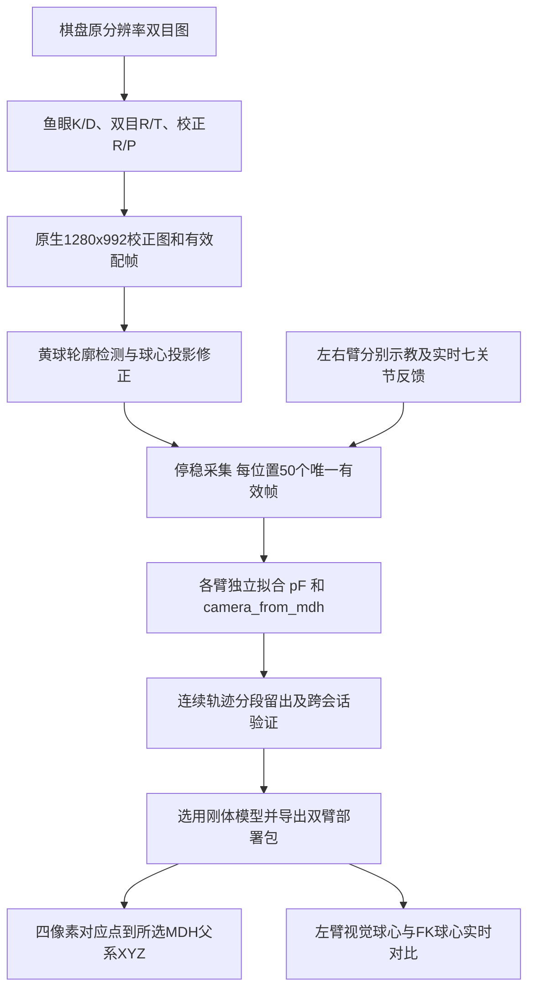

# head_eye_pro 双目与双臂标定流程

整理日期：2026-10-20。本文记录当时的 `vision_deploy v2.2.0` 刚体方案；当前已同步至共享pF联合补偿 v3.0.0，现行参数和接口以[部署说明](../vision_deploy/README.md)为准。本文的旧pF、固定右锚及旧部署导出命令仅供历史复现，不应覆盖现行部署。

本文涵盖相机标定、左右臂示教回放、pF 与相机外参拟合、误差验证、归档、部署及实时对比。以下操作命令默认在本机项目根目录执行，远端命令另行标注。

```bash
cd /home/lijingzhi/Project/Learned_IK/head_eye_pro
```

## 1. 当前配置与流程总览

| 项目 | 当前配置 |
|---|---|
| 项目目录 | `/home/lijingzhi/Project/Learned_IK/head_eye_pro` |
| Orin Pro | `192.168.12.123`，SSH 用户 `marvin` |
| 本机有线地址 | `192.168.12.101` |
| 机械臂控制器 | `192.168.12.190`，SDK/控制器版本 `00040701` |
| 机械臂 | M6S-CCS-696，双臂各 7 轴 |
| 左臂 | `ARM0`，MDH 链 `1004.ini:R.A0` |
| 右臂 | `ARM1`，MDH 链 `1004.ini:R.A1` |
| 图像左眼 / 右眼 | `CSI8` / `CSI0`，不能互换 |
| 单眼原分辨率 | 2560×1984，采集请求 30 FPS |
| 校正与检测尺寸 | 单眼 1280×992 |
| 预览尺寸 | 单眼 640×496，约 12 FPS；实际有效三维帧率会变化 |
| 棋盘 | 11×8 内角点，格边长 35mm |
| 黄球 | 球面投影修正使用直径 40mm 假设，需实物确认 |

密码通过交互输入或 `ORIN_PRO_PASSWORD` 环境变量提供，不写入文档、代码或 Git。



## 2. 坐标、像素和 pF 的定义

### 2.1 机械臂坐标

`left_arm_mdh_parent` 和 `right_arm_mdh_parent` 分别指 `R.A0`、`R.A1` 运动学链的父坐标系。当前尚未独立验证它们等于实际整机或机械臂物理 base，不应直接改名为 `base`。

设 `T_M_F(q)` 为所选臂 MDH 父坐标系到法兰的正运动学结果，其中 `R_M_F`、`t_M_F` 为旋转和平移。法兰到球心偏置 `pF` 表达在该臂的法兰局部坐标系中：

```text
FK球心（MDH父系） = R_M_F(q) × pF + t_M_F(q)
视觉球心（相机系） = R_C_M × FK球心 + t_C_M
视觉球心（MDH父系） = transpose(R_C_M) × (视觉球心（相机系） − t_C_M)
偏差向量 = 视觉球心（MDH父系） − FK球心（MDH父系）
三维偏差 = norm(偏差向量)
```

MDH 使用 `Rx(alpha) Tx(a) Rz(theta) Tz(d)`，关节行 `theta = Theta + q`，最后追加固定 FLANGE 行。INI 的长度为 mm、角度为 deg，内部位置运算转换为 m；显示通常为 mm。

左、右臂必须使用各自的反馈、MDH、外参和 pF，不能仅修改字段名称或镜像复用右臂参数。

### 2.2 图像坐标

- 标定 PNG 是未去畸变、未缩放的 2560×1984 ISP BGR 图，不是 Bayer RAW。
- `rectified` 接口坐标是未经显示旋转的 1280×992 校正域。
- 预览缩到 640×496，并将每眼旋转 180°以适应倒装。预览上的坐标不能直接输入原生接口。
- 黄球轮廓的椭圆中心一般不等于物理球心的投影。当前检测端已进行球心投影修正，实时接口使用 `corrected_stereo_pixels`。
- `vision_deploy` 只三角化真实对应点，不额外进行球面修正，也不自动加减 pF。pF 用于 FK 球心比较，不应从视觉球心中重复扣除。

## 3. 环境及启动前检查

### 3.1 SSH连接与只重启相机

本机在设备有线网段时，终端连接：

```bash
ssh marvin@192.168.12.123
```

按提示输入设备密码。SSH连接本身不连接机器人控制器。

如果画面正常但一直提示配帧时差超限，可在本机项目根目录只重启本项目相机采集，不启动第二个窗口或SDK连接：

```bash
/usr/bin/python3 -c "from orin_rectified_stream.start_pro_rectified import prepare_sender; prepare_sender(reuse_running=False)"
```

该命令会短暂停止测量、重新启动两路Argus并在约5秒后锁AE/AWB；执行前结束正式数据采集，实时窗口会暂时显示WAIT。10ms门槛是10毫秒，不是10秒。2026-10-21实测重启前10秒120条状态均拒绝，重启后40秒472/474条合格（99.6%），合格帧源时差中位数5.92ms/P95 9.33ms；这些是本次会话结果，不保证后续一直维持。

两路30FPS自由运行相机的周期约33.3ms，相位偏移后最近邻帧也可能相差约16.7ms。重启能够重新建立较好的采集相位，长期稳定的曝光同步仍需要厂商支持的外部触发及接线验证，不能通过修改时间戳或放宽门槛代替。

### 3.2 软件环境

- 本机实时程序使用 `/usr/bin/python3` 和支持 GStreamer 的系统 OpenCV，并依赖 NumPy、Paramiko。
- Orin 需要匹配 JetPack 的 Argus、GStreamer、相机驱动及 NVIDIA VPI。
- 厂商 SDK 位于项目的同级目录 `../00040701/`，包含 `PYTHON_SDK/GentoRobot.py` 和对应架构动态库。
- 离线多方案分析另需 `requirements-analysis.txt` 中的 SciPy、Matplotlib。建议在独立分析环境安装，避免替换实时程序使用的系统 OpenCV。

### 3.3 控制器连接占用

控制器 SDK 是独占连接。曾确认 Orin 上 `apex-robot` 容器中的 `marvin_robot_node` 持有 UDP 3720–3727，导致本机返回 `-22`。

如再次出现该占用，先确认相关应用可以停止，再在 Orin 上正常退出 Apex 界面、遥操作和机器人服务。例如：

```bash
ssh marvin@192.168.12.123
# 以下在Orin执行
sudo /usr/local/bin/apexctl stop teleop
sudo /usr/local/bin/apexctl stop robot
sudo systemctl stop apex-backend.service
```

Apex 桌面界面也需退出，避免重新启动控制模块。保留 `apex-dnsmasq` 等网络服务，不要为了断开机器人而停止网络。上述停止操作没有修改开机自启动。

`-22` 表示控制器拒绝连接，不等于本机一定有残留 Python 进程；SDK 的本机 `unlink` 不能强制释放其他设备的控制权。

### 3.4 现场检查

1. 相机及机器人安装固定，标定期间保持安装关系不变。
2. 黄球牢固安装在本次采集臂的法兰末端，两眼同时可见。
3. 控制器版本、目标臂 DOF、MDH 和实时反馈有效。
4. 目标臂为 IDLE，各关节距实时限位至少 2°；程序不自动清除故障。
5. 工作空间和返回末点路径可通行。当前返回功能是关节插值，不包含障碍物碰撞规划。

## 4. 双目相机内外参标定

### 4.1 原始棋盘采集

棋盘采集与校正推流互斥。再次采集前先正常退出实时对比，让机械臂回到 IDLE，再停止仅属于本项目的 Orin `pro_sender.py`，释放相机。不要直接运行旧 Luna 相机入口。

启动自动采集：

```bash
/usr/bin/python3 portable_stereo_fisheye_calibration/start_orin_pro.py --auto
```

恢复本次已有的原始图像会话：

```bash
/usr/bin/python3 portable_stereo_fisheye_calibration/start_orin_pro.py \
  --auto --resume data/raw_chessboard_20261019_153327
```

当前自动策略为：棋盘双眼完整检测、稳定至少 0.5s、相对历史姿态变化至少约 6 个预览像素，保存后冷却 0.6s；保存和完整分辨率验证在后台执行。保持棋盘停稳，改变位置、距离和倾斜角，覆盖视野与深度范围。Ctrl+C 结束时完成正在进行的保存并保留已有数据。

成像策略是 50Hz 防频闪，自动适应约 5s 后锁 AE/AWB。它复用了旧机策略，但不是复制旧机曝光/增益数值；属性锁定回读也不等于实测逐帧曝光。

棋盘对接受出队时差 ≤20ms；此门槛不同于后续球心测量的双时差 ≤10ms。两者都不是硬件曝光同步证明。

### 4.2 拟合原分辨率模型

以下命令展示本批参数，输出文件必须不存在；重新采集时替换输入和输出路径：

```bash
/usr/bin/python3 portable_stereo_fisheye_calibration/calibrate.py \
  --images data/raw_chessboard_20261019_153327 \
  --corners 11 8 --square-mm 35 --min-pairs 20 --balance 0 \
  --output configs/orin_pro_raw_fisheye_stereo_reproduced.json
```

拟合生成两眼 K/D、右眼相对左眼 R/T、`rectify_R1/R2/P1/P2/Q` 和像素质量指标。`calibrate.py` 只输出原始模型，不会自动覆盖当前部署参数或生成项目专用校正模型。

本批 65 对图像的结果：

| 指标 | 2560×1984原分辨率 |
|---|---:|
| 左眼 RMS | 0.110805px |
| 右眼 RMS | 0.104738px |
| 双目 RMS | 0.149801px |
| 校正角点纵差绝对值 P95 | 0.296672px |
| 基线长度 | 59.741807mm |

这些是同批图像拟合内指标，没有独立棋盘留出或外部位置真值，不能据此宣称三维 1mm 已达标。

### 4.3 生成并核对校正模型

本项目已有：

- `configs/orin_pro_raw_fisheye_stereo_20261019.json`：2560×1984 原始模型。
- `configs/orin_pro_rectified_stereo_20261019.json`：1280×992 理想针孔校正模型。

重新标定后，必须按相同数据结构生成新的校正模型，而不是直接复用旧文件。当前仓库没有独立的项目专用 raw→rectified 导出命令，转换规则为：

```text
S = diag(0.5, 0.5, 1)
left_P  = S × raw.rectify_P1
right_P = S × raw.rectify_P2
left_K/right_K = 对应校正P的前三列
畸变D = 0
校正后的相对R = I
校正后的相对T = raw.rectify_R2 × raw.right_from_left_T_m
source_calibration_sha256 = 新原始JSON文件的SHA256
```

必须保留基线和平移的符号。本机实测原始 `T.x` 及校正 P2 的 x 平移为正，前方点视差可能为负；不能照搬旧机正视差约束，也不能取绝对值修改外参。

尺寸缩小一半后，像素 RMS 和纵差指标也缩小一半。例如当前 1280×992 的校正纵差 P95 约为 0.148336px。校验方法见 `tests/test_rectified_geometry.py`。

采用新相机模型时，还须同步更新采集/拟合默认配置及部署参数。既有机械臂配准绑定旧相机哈希，不能只替换相机 JSON 后继续套用旧外参。

## 5. 校正预览、检测与配帧

```bash
/usr/bin/python3 orin_rectified_stream/start_pro_rectified.py
```

处理链为：

```text
Argus2560×1984@30 → 1280×992 → VPI CUDA校正
→ 原生像素黄球检测、有效配帧与三角化
→ 每眼640×496 H264预览 + UDP测量元数据
```

预览端口为 5120/5122，元数据端口为 5124。元数据与 H264 显示流分离，正式测量不从缩小、压缩或显示旋转后的图像取点。

严格配帧要求源时差和回调到达时差都 ≤10ms，每眼源帧不能重复。低配对率时仍可显示逐眼二维预览，但异步预览不会被当作合格三维测量。

仅 PASS 更新 `runtime/yellow_detection/latest.json`；全部状态更新 `latest_status.json`。已知有相机自由运行相位波动，重启后的高配对率不能保证后续一直保持。

厂商说明 `trig_mode=1` 需要适配板接收外部触发。此前模式1未得到有效图像，当前恢复为模式0自由运行；共同软件管线和 PTS 检查没有建立硬件曝光同步。

## 6. 左右臂分别示教、回放与50帧采集

### 6.1 只读预检

正式采集要求连续三个 5s 窗口，每个窗口至少获得 25 个双眼唯一 PASS 帧，然后校验控制器及所选臂。失败时不会进入拖动。

```bash
# 右臂ARM1/R.A1
bash scripts/teach_replay_ball.sh teach --check
# 左臂ARM0/R.A0
bash scripts/teach_replay_left.sh teach --check
```

### 6.2 拖动示教

将黄球装在相应臂上，二选一运行：

```bash
bash scripts/teach_replay_ball.sh teach
bash scripts/teach_replay_left.sh teach
```

只启动目标臂，避免两个 SDK 进程争用控制器。按住目标臂拖动按钮缓慢拖动，每约 3°记录一个位置；通常要求相邻点 1～5°，终止末段可小于 1°。至少 18 个示教点才能保存回放路径；当前离线分段拟合入口要求至少 30 个有效位置，采集时应留出无效点余量并覆盖多种空间位置和法兰姿态。

按 Ctrl+C 结束后保持末端稳定，程序尝试回到 IDLE 并保存完整轨迹。靠近关节安全余量、采样跨度过大或通信异常会中止，部分轨迹和已写数据仍保留。

如需同时打印和记录日志，必须让日志接收端忽略 SIGINT，避免 Ctrl+C 杀死 `tee` 后产生 Broken pipe：

```bash
set -o pipefail
bash scripts/teach_replay_left.sh teach 2>&1 | (trap '' INT; exec tee runtime/left_teach_replay.log)
```

### 6.3 返回末点与逆序回放

终端显示计划后输入 RUN，速度/加速度均为 SDK 的 5%。

- 当前姿态接近已教点：沿剩余已教路径前往末点。
- 不接近已教点：按当前姿态到末点的关节直线插值，每段最大约 5°，并检查限位和执行反馈。
- 返回末点阶段不采集；到达后从末点沿示教轨迹逆序采集。
- 控制过程中不采头姿，不控制头部，也不对另一条机械臂发送模式或位置命令。

复用已完成轨迹时：

```bash
bash scripts/teach_replay_left.sh replay data/left_drag_replay_时间/taught_trajectory.json
# 右臂对应使用teach_replay_ball.sh
```

中断保存的前缀需显式加 `--recover-partial`，仍验证侧别、版本、MDH/相机哈希、点数、限位及相邻步长，不把 `complete=false` 原文件伪装成正常结束的轨迹。

### 6.4 每位置的接受条件

| 检查 | 当前门槛 |
|---|---|
| 到位与停稳 | 距目标≤0.25°、速度≤0.5°/s，连续约0.7s |
| 正式采样 | 15s内收集50个有效且每眼不重复的源帧 |
| 采样期间关节 | 距目标≤0.3°、速度≤0.5°/s |
| 50帧关节窗口变化 | 任一关节跨度≤0.02° |
| 时差 | 源时差和到达时差各≤10ms |
| 本机测量时效 | 接收年龄≤250ms |
| 视差稳定性 | 原始及球心修正视差的绝对偏差P95均≤0.1px |
| 其他 | 曝光/白平衡锁定、原生尺寸/像素域/哈希一致，球心几何有效 |

“每点50帧”不是“50 FPS”。采样不足或抖动超限会写为 `capture_valid=false` 并保留证据，不能把完成回放等同于全部点有效。

## 7. 数据结构与归档

本机采集目录包含 `session.json`、`status.json`、完整/部分轨迹 JSON、`replay_capture.jsonl`。每个回放位置一条记录，通常含：

- 设备、臂侧、MDH 和相机标定来源哈希；示教点编号和目标七关节角。
- 有效点的融合关节角、法兰位置/旋转、球心XYZ、像素中位数、视差及三维抖动。
- 逐帧左右球心/椭圆、原始与已修正像素、三角化XYZ、质量、源PTS和双时差。
- 逐帧实际关节角、控制器反馈序号、本机反馈和元数据接收时间。
- `capture_valid`、有效帧数及拒绝原因。无效位置可能没有融合结果，但保留已收集帧。

回放不保存原始相机图像、头姿或关节力矩。保存了像素和检测证据，不等于可以重新运行图像检测或重新标定相机内参。

| 已归档批次 | 全部位置 | 有效/无效 | 全部逐帧观测 | 用于拟合的帧数 |
|---|---:|---:|---:|---:|
| 右臂首批142点 | 142 | 142/0 | 7100 | 7100 |
| 右臂第二批360点 | 360 | 288/72 | 17962 | 14400 |
| 左臂482点 | 482 | 424/58 | 24090 | 21200 |

仓库 `datasets/` 保存 JSONL、轨迹和日志的无损 gzip，另有会话/状态、README、`manifest.json` 及压缩前后 SHA256。本机 `data/` 和 `runtime/` 默认忽略；有效点和无效点都归档，不按误差删除原始记录。解压可使用 `gzip -dk 文件名.gz`；拟合程序也可以直接读取gzip。

三批目录分别为：

- `datasets/drag_replay_20261019_191653_275606/`
- `datasets/drag_replay_20261020_091535_901340/`
- `datasets/left_drag_replay_20261020_110645_673779/`

## 8. 独立拟合每条机械臂

对有效位置，模型联合估计 3维 pF、3维旋转和3维平移：

```text
X_C,i ≈ R_C_M × (R_M_F(q_i) × pF + t_M_F(q_i)) + t_C_M
```

程序先校验数据身份、历史时效、源帧唯一性，重新计算50帧融合和MDH FK，与保存记录对照。只使用 `capture_valid=true` 的点，不为降低残差再次删点。

使用已归档批次复现，输出路径应为新文件：

```bash
/usr/bin/python3 -m interactive_ball_calibration.pro_fit \
  --arm right \
  --capture datasets/drag_replay_20261020_091535_901340/replay_capture.jsonl.gz \
  --output /tmp/pro_right_288_reproduced.json

/usr/bin/python3 -m interactive_ball_calibration.pro_fit \
  --arm left \
  --capture datasets/left_drag_replay_20261020_110645_673779/replay_capture.jsonl.gz \
  --output /tmp/pro_left_424_reproduced.json
```

更换输入批次后应生成新模型，不覆盖历史结果。输出 JSON 包含 pF、正逆变换、配置/数据哈希、全量拟合和分段验证指标；同名 CSV 保存逐点误差。

本历史刚体版本使用的 pF（mm，非当前v3.0.0）：

| 所属法兰局部坐标系 | X | Y | Z |
|---|---:|---:|---:|
| 右臂 | 1.081859 | −0.328129 | 101.347729 |
| 左臂 | 0.195295 | 0.725531 | 99.374025 |

运算读取 JSON 全精度值，不使用表格中的四舍五入数值。

## 9. 误差评估与模型选择

### 9.1 评估方法

三维位置误差定义为预测球心与双目测量球心的欧氏距离，分别报告均值、RMS、中位数、P95、最大值、单轴RMS及≤1mm比例。

验证按有效位置的轨迹顺序分成5个连续段，每次留出一个段，排除其两侧各2个邻近位置后训练。同一点的50帧始终属于同一侧，不随机打散到训练与验证中。最后发布模型才用全部有效点拟合；不能把发布模型的训练残差称为留出误差。

右臂有两批数据，额外做旧批拟合→新批预测、新批拟合→旧批预测。左臂目前仅一批，尚无独立第二批左臂验证。跨会话结果仍不是外部绝对位置真值。

### 9.2 当前结果

| 模型与数据 | 拟合RMS/P95（mm） | 连续段留出RMS/P95（mm） |
|---|---|---|
| 右臂首批142点 | 0.857 / 1.515 | 1.187 / 2.112 |
| 当前右臂288有效点 | 0.817 / 1.569 | 0.912 / 1.678 |
| 当前左臂424有效点 | 0.814 / 1.438 | 0.866 / 1.520 |

右臂旧→新跨会话 RMS/P95 约1.046/1.895mm，新→旧约1.202/2.339mm。

**当前左右臂都没有通过验证P95≤1mm。** 单点实时误差偶尔低于1mm，只代表该时刻与当前模型的相符程度，不代表整个空间达标。

### 9.3 多方案分析

曾比较普通刚体、Huber、协方差加权、像素重投影、相似变换、逆深度补偿和仿射。部署保留普通刚体：仿射即使统计RMS更低，也包含伸缩/剪切，不能直接当作刚体旋转 R；当前没有独立尺寸证据支持把尺度变化解释成相机修正。

在已安装 `requirements-analysis.txt` 依赖的分析环境中复现：

```bash
OPENBLAS_NUM_THREADS=1 python -m interactive_ball_calibration.compare_pro_calibration \
  --arm right --dataset datasets/drag_replay_20261020_091535_901340 \
  --reference-dataset datasets/drag_replay_20261019_191653_275606 \
  --output /tmp/pro_right_methods_reproduced

OPENBLAS_NUM_THREADS=1 python -m interactive_ball_calibration.compare_pro_calibration \
  --arm left --dataset datasets/left_drag_replay_20261020_110645_673779 \
  --output /tmp/pro_left_methods_reproduced
```

输出目录必须不存在。`best_candidate.json` 可能是仿射实验结果，不能只看文件名就用于刚体部署。

## 10. 双臂父坐标系对齐

保留现有右臂配准作为固定锚，左臂独立决定自身相机外参，再通过共同相机得到：

```text
T_right_mdh_from_left_mdh = inverse(T_camera_from_right_mdh) × T_camera_from_left_mdh
```

复现当前对齐：

```bash
/usr/bin/python3 -m interactive_ball_calibration.align_arm_frames \
  --left configs/orin_pro_left_ball_registration_20261020_424.json \
  --output /tmp/pro_dual_arm_right_reference_reproduced.json
```

该命令的默认右臂输入是 `reports/pro_recalibration_20261020_360/rigid_candidate.json`，不是仿射 `best_candidate.json`。

这里的双臂变换不是独立测量的物理安装变换；左臂留出误差刚体变换到右父系后距离不变，但没有包含右臂锚的不确定度。两臂各自的 pF 仍属于各自法兰坐标，不能直接作为另一臂坐标向量使用。

## 11. vision_deploy 参数导出与调用

### 11.1 参数导出

```bash
/usr/bin/python3 vision_deploy/export_calibration.py \
  --output /tmp/vision_dual_arm_calibration_reproduced
```

默认使用当前原始/校正相机模型、`1004.ini`、右臂288点刚体候选和左臂424点刚体模型。输出路径必须不存在。校验通过后才采用新参数，不要手工改部署 JSON 而不更新清单。

部署参数包括相机模型、两臂相机刚体外参、父系对齐、pF证据、完整机器人MDH及SHA256清单。`manifest.json` 字节哈希可能受数值序列化的极小浮点舍入差异影响，比较几何一致性时应同时核对实际参数；不能只把 bundle ID 不同等同于毫米级几何变化。

### 11.2 接口输入输出

在安装好包的业务环境中：

```python
from stereo_robot import StereoRobot

vision = StereoRobot()  # 循环外加载一次
result = vision.predict(
    [uL, vL, uR, vR],
    arm='left',
    pixel_domain='rectified',
    units='mm',
)
print(result['xyz'], result['frame'])
```

`arm`选择输出坐标系，不是目标安装在哪条机械臂。相机采集、检测和同步由外部程序完成；接口不接收关节角，不替用户建立硬件曝光同步。原始2560×1984鱼眼像素可用 `pixel_domain='raw_fisheye'`，默认校正域是1280×992。

通用目标推理不使用 pF。只有在核对法兰上黄球的 FK 时，外部程序才将该臂 pF 乘入 FK。若输入的是黄球轮廓中心，应先在检测端进行物理球心投影修正。

默认输出是所选臂的MDH父系。需要真实基座坐标时，先提供实测并确认的 `base_from_mdh_T`，再用 `require_base=True`；不能为了通过检查而把 `base_frame_verified` 人工设为真。

## 12. 左臂视觉与FK实时核对

一键启动，可从任意目录执行：

```bash
/usr/bin/python3 /home/lijingzhi/Project/Learned_IK/head_eye_pro/start_left_live_compare.py
```

该入口在部署包之外实现，不改动 `vision_deploy`。它会复用正常相机采集；需要时提示 Orin SSH 密码并准备相机，再显示双目图像与等待状态。独立完成控制器版本、左臂IDLE/MDH、限位和反馈预检后进入ARM0拖动，不等待合格双目帧；视觉/FK数值仍须通过原有测量质量检查。

画面下方显示左父MDH系中的视觉球心XYZ、使用最新左pF计算的FK球心XYZ、差值 `Vision−FK`、三维距离、时效及移动/静止状态。

| 正式采集 | 实时对比 |
|---|---|
| 3个连续5s窗口各至少25个有效帧，随后每点融合50帧 | 不要求上述吞吐量；持续等待新鲜合格测量 |
| 采样不足或抖动超限标为无效位置 | 低配对率显示WAIT，窗口不因帧率不足退出 |
| 用于离线标定 | 用于现场观察，不代替离线验证 |

两者都保留每帧源/到达时差≤10ms、配置一致性和时效检查。实时误差在相机测量超过250ms或关节反馈过期时隐藏。

实时对比按本机报文接收时刻选择最近的左臂关节反馈，允许最多50ms差，并显示该时间差。它没有与实际曝光对齐；拖动时误差包含时延，应停稳再判断静态偏差。

按 Q/Esc 或 Ctrl+C 关闭，会尝试将左臂切到IDLE并断开SDK。重复启动会识别实际运行进程或退出清理，不会把旧终端里的命令文字当作活动窗口。

## 13. 常见问题

| 现象 | 判断和处理 |
|---|---|
| `-22 Controller has already linked by other client` | 查看本机及Orin客户端，重点检查Apex机器人容器；不要直接抢占或重启控制器 |
| 左臂处于Error | 在当前控制端确认故障原因并处理，回到IDLE后断开原客户端；脚本不会自动清错 |
| 距限位不足2° | 先通过控制器移回安全余量内；不要直接修改程序门槛 |
| `Camera sustained preflight failed` | 正式采集吞吐量不足；检查新鲜数据、有效配对率、曝光锁定和黄球可见性；实时入口已改为等待而非使用该门槛 |
| 窗口关闭后说“已运行” | 使用已修复的启动器；旧终端文字不再算进程，真正退出清理时等待其完成 |
| `Cannot query video position` | 直播GStreamer流无法查询文件播放位置的警告，本身不是退出原因 |
| `Broken pipe` | 检查日志tee是否随Ctrl+C退出，按本文SIGINT写法运行 |
| 画面为STALE/元数据停留在旧时间 | 检查Orin sender、本机接收进程和网络；旧PASS文件不能当作当前测量 |
| 配对率重启后变化 | 自由运行启动相位问题仍存在；不可通过改时间戳、重复帧或扩大门槛宣称同步解决 |
| bundle ID略有不同 | 先核对文件SHA、参数和版本；已有一次导出差异约1.9e-16，运行时几何未变，不要盲目替换有效参数 |

## 14. 当前验收结论与下一步

已完成相机65对棋盘标定、两臂独立pF/相机外参估计、有效数据筛选、轨迹分段及右臂跨会话验证、双臂部署和左臂实时对比。

仍需独立验证：球实际尺寸/安装偏置、真实基座与MDH父系关系、双臂物理安装关系、硬件曝光同步及全工作空间绝对位置误差。下一步应使用独立量具/已知位置真值，补充不同空间和末端姿态的第二批左臂数据，使用冻结参数直接预测后再评价是否需要重标定。

如果更换相机、镜头、机器人或安装位置，需要重新标定相应参数；只换计算设备且物理安装不变时才可转移当前参数。

## 15. 相关文件

- [相机标定结果](双目鱼眼标定结果_20261019.md)
- [右臂第二批重标定与跨会话验证](../reports/pro_recalibration_20261020_360/report.md)
- [左臂标定与固定右臂参考](../reports/pro_left_registration_20261020_482/report.md)
- [部署接口与参数说明](../vision_deploy/README.md)
- [相机连接及驱动说明](../vision_deploy/stereo_robot/docs/camera_connection.md)
- [原生机器人MDH与坐标说明](../vision_deploy/stereo_robot/docs/robot_model.md)
- [一键实时对比入口](../start_left_live_compare.py)
