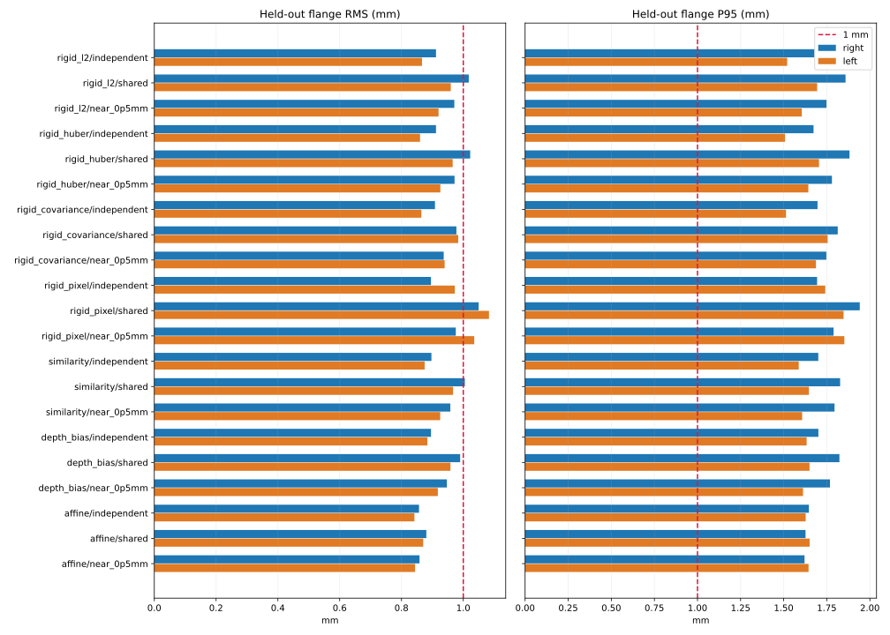

# 双臂同型黄球连接件：共享pF重标定与误差分析

日期：2026-10-20。用户确认两侧连接件同尺寸、同定位安装方向。本次检查远程仓库至 `2c073de`，没有新增采集；使用最新右臂288点和左臂424点。

**结论：21个组合均未达到双臂留出P95≤1mm。两臂共享pF是合理的待验证物理约束，但强制共享后，当前刚体模型的数据一致性下降。当前部署v2.4.0与固定右臂锚保持原结果，本次参数另存为可检查候选。**

## 数据与物理假设

- 右臂360条记录中288有效/72拒绝，14400帧；左臂482条中424有效/58拒绝，21200帧。拒绝点未重新纳入，没有按拟合残差删点。
- 校验归档清单哈希/字节数、相机和MDH来源、帧唯一性、50帧融合及原生FK。相机内参/畸变/双目几何与MDH保持固定。
- 两臂MDH数值行相同，重力/安装方向配置不同；同型连接件同定位是用户提供的物理信息，并不独立证明关节零位、法兰实际坐标轴和模型完全准确。
- 若所有坐标定义与安装完全一致，pF应相同或很接近。各臂独立估计的差异也可能吸收了系统偏差，不能直接解释为连接件制造误差。
- 原独立pF之差（右−左）约 [0.886566, -1.053661, 1.973703] mm，向量长度 **2.406596 mm**。

## 方法与验证

七种模型（普通刚体、Huber、协方差加权、像素重投影、尺度、逆深度偏差、仿射）各配三种pF策略，共21组合。

| pF策略 | 约束 |
|---|---|
| independent | 各臂独立估计3维pF |
| shared | 两臂使用同一个3维pF |
| near_0p5mm | 共用中心偏置±差异/2，每个差异分量限定±0.5/√3mm，因此向量差≤0.5mm |

0.5mm是本次敏感性分析的安装差异假设，不是实测公差。采用的是球内的轴对齐盒约束，并非在整个0.5mm球面上搜索。所有near组合最终都触及差异约束，说明在该模型/数据下仍倾向于更大的pF差异。

共享/near拟合同时估计两臂各自外参；本次新候选的右外参不是原固定锚。每个有效位置贡献一次残差，左臂点数更多，自然具有更多观测；协方差加权还按窗口噪声分配权重。

外层5折：两臂各按轨迹顺序留出对应区块，两侧剔除相邻2个有效位置。内层4折只在外层训练数据中选择方案。两臂测试区块均不参与训练；每个位置的50帧不跨训练/验证。

选型优先最小化两臂中较大的P95，再比较较大的RMS；同时分别记录全部模型、仅刚体、仅共享pF刚体三个选型组。没有把左右臂合并成一个平均分掩盖较差的一侧。

误差直接按 **相机观测经模型逆映射→减去FK旋转后的pF→视觉法兰原点，与FK法兰原点相减** 计算，单位mm。尺度/逆深度/仿射使用完整逆映射，因此这些分数与旧报告只在相机域评价的数值略有差异。

## 21组合的留出结果

| 模型 / pF策略 | 右RMS | 右P95 | 右最大 | 右≤1mm | 左RMS | 左P95 | 左最大 | 左≤1mm |
|---|---:|---:|---:|---:|---:|---:|---:|---:|
| rigid_l2/independent | 0.912 | 1.678 | 3.020 | 73.26% | 0.866 | 1.520 | 3.276 | 77.36% |
| rigid_l2/shared | 1.018 | 1.859 | 2.807 | 65.28% | 0.960 | 1.694 | 2.665 | 67.22% |
| rigid_l2/near_0p5mm | 0.971 | 1.748 | 2.854 | 69.79% | 0.920 | 1.605 | 2.791 | 71.46% |
| rigid_huber/independent | 0.912 | 1.673 | 3.054 | 72.92% | 0.860 | 1.508 | 3.207 | 77.83% |
| rigid_huber/shared | 1.022 | 1.882 | 2.839 | 63.54% | 0.966 | 1.705 | 2.573 | 66.75% |
| rigid_huber/near_0p5mm | 0.972 | 1.780 | 2.884 | 69.44% | 0.926 | 1.643 | 2.701 | 71.70% |
| rigid_covariance/independent | 0.908 | 1.696 | 3.089 | 74.31% | 0.864 | 1.513 | 3.167 | 76.65% |
| rigid_covariance/shared | 0.978 | 1.813 | 2.860 | 69.10% | 0.984 | 1.755 | 2.602 | 66.04% |
| rigid_covariance/near_0p5mm | 0.937 | 1.747 | 2.918 | 73.61% | 0.940 | 1.687 | 2.695 | 70.28% |
| rigid_pixel/independent | 0.895 | 1.694 | 3.098 | 79.51% | 0.973 | 1.741 | 2.662 | 70.28% |
| rigid_pixel/shared | 1.050 | 1.941 | 3.492 | 64.58% | 1.083 | 1.847 | 2.585 | 58.49% |
| rigid_pixel/near_0p5mm | 0.976 | 1.789 | 3.406 | 69.44% | 1.035 | 1.852 | 2.520 | 63.44% |
| similarity/independent | 0.897 | 1.701 | 2.918 | 76.04% | 0.875 | 1.587 | 3.478 | 77.36% |
| similarity/shared | 1.005 | 1.827 | 2.609 | 66.32% | 0.967 | 1.646 | 2.927 | 67.69% |
| similarity/near_0p5mm | 0.958 | 1.795 | 2.621 | 71.88% | 0.925 | 1.607 | 3.033 | 71.46% |
| depth_bias/independent | 0.896 | 1.701 | 2.926 | 75.69% | 0.884 | 1.633 | 3.849 | 77.36% |
| depth_bias/shared | 0.990 | 1.823 | 2.599 | 68.75% | 0.959 | 1.650 | 3.384 | 69.34% |
| depth_bias/near_0p5mm | 0.947 | 1.768 | 2.659 | 73.26% | 0.918 | 1.612 | 3.453 | 72.17% |
| affine/independent | 0.857 | 1.646 | 2.874 | 78.82% | 0.842 | 1.627 | 3.449 | 79.72% |
| affine/shared | 0.880 | 1.627 | 2.666 | 78.47% | 0.870 | 1.650 | 3.298 | 77.12% |
| affine/near_0p5mm | 0.858 | 1.621 | 2.602 | 78.82% | 0.844 | 1.644 | 3.354 | 78.77% |



RMS<1mm只表示平方平均误差小于1mm，不能解释为95%或全部点都小于1mm。最佳单次选型分数仍可能乐观，下面单列内外层隔离的嵌套流程指标。

## 嵌套选型的泛化估计

| 选型范围 | 右RMS | 右P95 | 右≤1mm | 左RMS | 左P95 | 左≤1mm |
|---|---:|---:|---:|---:|---:|---:|
| all | 0.885 | 1.637 | 77.78% | 0.868 | 1.656 | 77.12% |
| rigid | 0.914 | 1.702 | 74.31% | 0.866 | 1.520 | 77.83% |
| shared_rigid | 1.005 | 1.878 | 65.62% | 0.968 | 1.698 | 65.80% |

嵌套分数评价每折在训练数据上选型的流程，不是单个全量模型的绝对精度。只有单会话/臂的有效位置，仍缺少独立位置真值。

## 可检查的参数候选

### all：affine/near_0p5mm

- [右臂参数](affine__near_0p5mm/right.json)，[左臂参数](affine__near_0p5mm/left.json)。
- right pF（本臂法兰局部，mm）：`[0.9094129473550367, 0.046625644073773814, 100.77140885429812]`。
- left pF（本臂法兰局部，mm）：`[0.6207378127602238, 0.33530077866858665, 100.48273371970329]`。
- 该候选含尺度/剪切，不能作为刚体R直接放入vision_deploy；它并未达到双臂P95≤1mm。

### rigid：rigid_huber/independent

- [右臂参数](rigid_huber__independent/right.json)，[左臂参数](rigid_huber__independent/left.json)。
- right pF（本臂法兰局部，mm）：`[1.1141947019008602, -0.379913211478136, 101.4073432180387]`。
- left pF（本臂法兰局部，mm）：`[0.16710955072962264, 0.7253268257013701, 99.38768874583701]`。

### shared_rigid：rigid_covariance/shared

- [右臂参数](rigid_covariance__shared/right.json)，[左臂参数](rigid_covariance__shared/left.json)。
- right pF（本臂法兰局部，mm）：`[0.6502433774151246, 0.047527042314286234, 100.31800418293638]`。
- left pF（本臂法兰局部，mm）：`[0.6502433774151246, 0.047527042314286234, 100.31800418293638]`。
- 该候选保持刚体形式且pF完全相同，但验证尾部误差高于原独立刚体。保存外参和对齐供复查，不替换现有部署。

## pF一致性与误差来源分析

1. **纯共享约束没有消除系统不一致。** 普通刚体共享解是两套数据的折中；相同几何先验不能凭空修正相机、关节零位、柔性或安装坐标定义误差。
2. **姿态与偏置耦合仍需检查。** 独立pF在连续留出折中的范围列于下表；这些折的训练集高度重叠，范围/标准差只是稳定性描述，不能当作置信区间。

| 独立刚体pF | 全量XYZ mm | 五折训练解最小XYZ mm | 最大XYZ mm |
|---|---|---|---|
| right | [1.0819, -0.3281, 101.3477] | [1.0372, -0.541, 101.0663] | [1.1088, -0.2522, 101.7202] |
| left | [0.1953, 0.7255, 99.374] | [0.078, 0.5383, 99.1612] | [0.4665, 1.0193, 99.5783] |

3. **帧内抖动与系统残差不同。** 下表是每位置50帧相对其三维中位数的95%半径分布，不能拿它替代绝对精度：

| 臂 | 窗口P95半径的中位数 mm | 窗口P95半径的95分位 mm | 最大 mm |
|---|---:|---:|---:|
| right | 0.332 | 0.841 | 1.211 |
| left | 0.365 | 0.645 | 1.163 |

4. **共享约束需改变外参才能成立。** 下表比较共享刚体候选与当前部署对同一相机点输出的MDH坐标差，仅表示参数更新幅度，不是真值误差：

| 臂 | 坐标变化RMS mm | P95 mm |
|---|---:|---:|
| right | 1.120 | 1.175 |
| left | 1.195 | 1.293 |

5. **沿用现有右pF直接约束左臂并非更优。** 固定右臂现有pF，只重估左R/t，左臂训练RMS=1.094mm、P95=1.891mm。这只是条件训练误差，不能称为独立留出验证。

现有数据不能唯一定位误差来源。可能因素包括球轮廓到球心修正（40mm直径假设）、相机残余畸变/视差偏差、两场采集间安装变化、机械臂关节零位与实际MDH偏差、受力挠曲和法兰局部坐标定义。拟合更灵活的仿射矩阵可吸收其中一部分，但并未证明物理原因，也未使P95达到1mm。

## 若要求大多数位置小于1mm，下一步怎么采

- 独立测量连接件法兰定位面/原点到球心的三维偏置，同时核对法兰局部轴向；“同型同定位”提供一致性先验，不能替代该实测。
- 在重叠工作空间内，两臂分别从多种末端姿态到达多个共同球心位置；同时包含近似固定姿态的平移采样，帮助区分pF、外参和姿态相关误差。记录受力/负载与相机安装状态。
- 保留独立日期或独立轨迹作为最终验收集，验收前不再用于调参；同时报告左右臂三维P95、最大值和≤1mm比例。
- 对真实业务目标使用独立已知位置基准测试。黄球换算法兰用到pF及FK姿态，而普通目标实时推理不用它们；本次结果不能保证任意物体单帧定位精度。

## 文件与复现

- [软件测试与结果复核](VALIDATION.json)：合成恢复测试、全部留出模型逆算、无泄漏划分与导出校验。
- [完整结果及每折模型](comparison.json)：21组合、内层分数、外层划分、全量模型、嵌套指标与来源清单。
- [逐点留出法兰误差](heldout_flange_errors.csv)：原生MDH坐标下XYZ残差，保留所有有效位置。
- [共享刚体候选坐标对照](shared_rigid_candidate_coordinates.csv)：两臂统一到**本次重新估计的候选右MDH参考**，含视觉球心、视觉法兰和FK法兰；该表是全量拟合对照，不是留出误差。
- [诊断与部署哈希](diagnostics.json)：pF差异、折间稳定性、帧内抖动与部署保持原值的记录。
- 每个 `方法__策略/` 子目录包含左右参数；刚体候选另含 `alignment.json`。同一候选的左右文件必须成对使用。

在仓库根目录执行，输出目录必须不存在：

```bash
python -m interactive_ball_calibration.compare_dual_pf --output /tmp/dual_pf_comparison
python -m interactive_ball_calibration.summarize_dual_pf /tmp/dual_pf_comparison
python -m unittest tests.test_dual_pf -v
```

未连接机器人/相机，未执行运动，未修改vision_deploy参数，也未声称1mm绝对精度验收通过。
