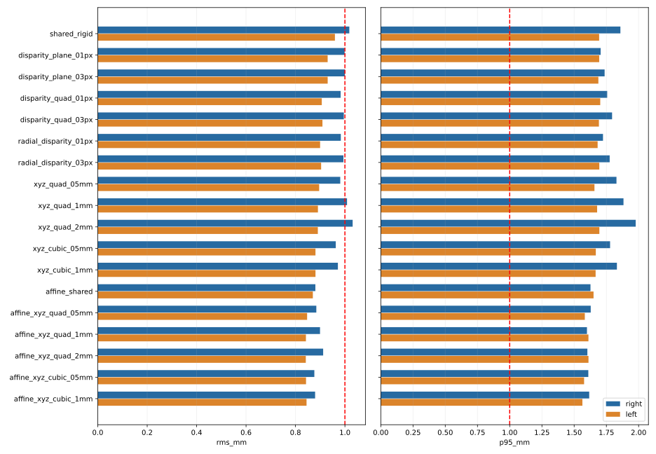

# 共享pF与相机观测补偿：算法改进实验

日期：2026-10-20。基于最新右臂288点/14400帧、左臂424点/21200帧；两侧连接件同尺寸、同定位安装方向由用户确认。

**本轮比较18个模型/正则组合，所有模型严格共享一个pF。最佳候选为 `affine_xyz_cubic_05mm`，仍未达到双臂留出P95≤1mm。** 当前vision_deploy v2.4.0保持原参数，新模型单独存储，未连接硬件。

## 本轮改进了什么

先前主要改变各臂映射和pF约束。本轮引入两臂共用的相机观测修正函数f(y)，允许相同空间区域的系统偏差被统一补偿；各臂使用各自刚体或仿射映射。正则项限制补偿幅度，运行时只需相机XYZ与选定臂，不需关节角。

```text
左右像素 → 原双目三角化得到y → 共用修正f(y) → 各臂逆映射 → 目标MDH坐标
标定验证时：目标MDH坐标 − FK旋转×共享pF → 视觉法兰原点，与FK原点比较
```

相机K/D、左右相对R/T、P_L/P_R与MDH未重新标定。新增函数是经验观测补偿，不能证明修正项全部来自相机；也可能吸收机械臂几何、球心检测或受力误差。

| 家族 | 修正内容 |
|---|---|
| shared_rigid / affine_shared | 无新增观测修正，作为共享pF基线 |
| disparity_plane | 视差偏差为归一化图像位置的一次函数，共3系数 |
| disparity_quad | 视差偏差为图像位置的二次函数，共6系数 |
| radial_disparity | 二次视差偏差加2个径向系数 |
| xyz_quad | 归一化相机XYZ的二次向量场，共18系数 |
| xyz_cubic | 二次及三次向量场，共48系数 |
| affine_xyz_* | 各臂仿射映射加两臂共用的上述向量场 |

## 方程与约束

$$f(y_i)=M_s(a_i+Q_i p_F)+t_s,$$

s表示机械臂；刚体方案M_s为旋转R_s，仿射方案M_s为一般线性矩阵。两臂只有一个共享pF。

$$\min\sum_{s,i}\left\|rac{M_s(a_i+Q_i p_F)+t_s-f(y_i)}{0.001}
ight\|^2+\sum_j(c_j/\sigma_j)^2.$$

0.001m是拟合中数据残差的尺度，用于定义正则项相对权重，不是人为把误差缩放到1mm。报告误差均按未缩放的米制坐标计算后乘1000。

视差修正使用u=(X/Z)/0.5、v=(Y/Z)/0.5，Δd由[1,u,v]或[1,u,v,u²,uv,v²]组合。当前带符号投影常数q=P_R[0,3]，修正f(y)=y/(1−Δd·Z/q)。径向扩展再对X/Y乘1+k1·r²+k2·r⁴，其中r²=(X/Z)²+(Y/Z)²。

XYZ修正先令(x,y,z)=(y−[0,0,0.4])/0.2（米），使用二次基[ x²,xy,xz,y²,yz,z² ]；三次再加入[ x³,x²y,x²z,xy²,xyz,xz²,y³,y²z,yz²,z³ ]。f(y)=y+Φ(y)C，没有额外常数或一次项。

视差系数正则尺度为0.1/0.3px；径向系数为0.005；XYZ系数为0.5/1/2mm（具体组合见表）。仿射元素限制在同折初始仿射解附近±0.03，最终奇异值须在0.9～1.1之间；相机/偏置物理边界及优化收敛均检查。最终模型未触及参数边界。

## 留出结果

| 方案 | 右RMS mm | 右P95 mm | 右≤1mm | 左RMS mm | 左P95 mm | 左≤1mm |
|---|---:|---:|---:|---:|---:|---:|
| shared_rigid | 1.018 | 1.859 | 65.28% | 0.960 | 1.694 | 67.22% |
| disparity_plane_01px | 0.999 | 1.706 | 65.97% | 0.930 | 1.694 | 70.99% |
| disparity_plane_03px | 1.000 | 1.736 | 65.62% | 0.930 | 1.688 | 70.75% |
| disparity_quad_01px | 0.983 | 1.756 | 68.06% | 0.906 | 1.702 | 74.53% |
| disparity_quad_03px | 0.996 | 1.794 | 67.71% | 0.909 | 1.692 | 74.29% |
| radial_disparity_01px | 0.983 | 1.724 | 68.06% | 0.900 | 1.682 | 75.24% |
| radial_disparity_03px | 0.994 | 1.776 | 69.44% | 0.904 | 1.695 | 74.53% |
| xyz_quad_05mm | 0.981 | 1.828 | 70.83% | 0.896 | 1.657 | 73.35% |
| xyz_quad_1mm | 1.009 | 1.883 | 70.83% | 0.891 | 1.678 | 75.00% |
| xyz_quad_2mm | 1.031 | 1.977 | 70.14% | 0.890 | 1.696 | 76.18% |
| xyz_cubic_05mm | 0.963 | 1.779 | 72.22% | 0.881 | 1.668 | 74.76% |
| xyz_cubic_1mm | 0.972 | 1.832 | 72.92% | 0.881 | 1.666 | 75.94% |
| affine_shared | 0.880 | 1.627 | 78.47% | 0.870 | 1.650 | 77.12% |
| affine_xyz_quad_05mm | 0.884 | 1.629 | 77.08% | 0.847 | 1.583 | 78.54% |
| affine_xyz_quad_1mm | 0.899 | 1.599 | 76.39% | 0.842 | 1.611 | 78.77% |
| affine_xyz_quad_2mm | 0.912 | 1.603 | 76.39% | 0.842 | 1.611 | 79.25% |
| affine_xyz_cubic_05mm | 0.876 | 1.610 | 78.47% | 0.843 | 1.577 | 78.77% |
| affine_xyz_cubic_1mm | 0.879 | 1.617 | 77.43% | 0.845 | 1.564 | 79.25% |



## 最佳候选参数与限制

- 两臂共享pF（本臂法兰局部，mm）：`[0.8018372093758807, 0.16874744075424306, 100.65535753816499]`。
- [完整模型](affine_xyz_cubic_05mm.json)：左右M/t、共享pF、共用补偿系数、基函数归一化、正则设置及训练覆盖范围。
- 共75个变量：两臂各12个仿射参数、3个共享pF及48个三次场系数。高阶场通过正则约束，不把低训练残差当作精度证明。

| 指标 | 右臂 | 左臂 |
|---|---:|---:|
| rms_mm | 0.876305 | 0.842689 |
| p95_mm | 1.609819 | 1.577077 |
| max_mm | 2.581834 | 2.918958 |
| fraction_within_1mm | 0.784722 | 0.787736 |

嵌套选型流程：右RMS/P95=0.888/1.607mm，左=0.848/1.594mm。每折只在训练数据上选模型与正则强度，随后验证该折的未见位置。

与此前仿射＋≤0.5mm差异候选相比，原右RMS/P95=0.858/1.621mm、左=0.844/1.644mm。本次严格相同pF后，P95有所改善，但右RMS略升，不是所有指标都改善。与原部署独立刚体相比，原左P95=1.520mm仍低于本次候选，因此不应宣称全面优于原部署。

左右臂验证点误差≤1mm的比例约78%，尚非95%。该流程仍使用静态50帧融合球心，不能保证任意物体单帧达到同样精度。

## 如何避免自欺式降误差

- 原712个有效位置完整保留，未按残差删除坏点；拒绝位置也未重新纳入。
- 两臂同时按轨迹分5个外层区块，两侧剔除相邻2个有效位置；内层4折选择模型与正则。同一位置50帧不跨训练/验证。
- 验证用完整逆映射计算视觉法兰误差；仿射矩阵使用真正的逆矩阵，不用转置冒充逆矩阵。
- 研究过程中已经反复查看同一批数据，嵌套选型只能减少本轮内部选型偏差，不能消除跨轮研究决策带来的偏差。最终需要独立会话/位置真值确认。
- 共用修正对两臂相同，但两臂空间/姿态覆盖并不相同；不能据此独立确认它是物理相机畸变。

## 实验调用方式

以下在安装分析依赖的原仓库环境执行，属于实验模型调用，不是当前vision_deploy的默认接口：

```python
import json
import numpy as np
from pathlib import Path
from vision_deploy.stereo_robot import StereoRobot
from interactive_ball_calibration.refine_shared_camera import camera_to_arm
model = json.loads(Path('reports/shared_camera_affine_refinement_20261020/affine_xyz_cubic_05mm.json').read_text())
measurement = StereoRobot().predict([710, 569, 764, 569], arm='right')
xyz_m = camera_to_arm(np.array([measurement['camera_xyz_m']]), model, 'right')[0]
print(xyz_m * 1000)  # 实验模型对应的右MDH父系坐标，mm
```

运行目标点反算只需y与所选臂：P_s=M_s⁻¹(f(y)−t_s)，不加减pF。法兰误差验证才减去Q_i·pF。模型包含非线性修正和非刚体M，不能只取M/t放入现有刚体加载器。

多项式超出采集区域可能快速放大误差；即使在训练包围盒内，也未验证任意位置精度。该实验函数未替代生产接口的完整输入/范围检查。

## 文件与复现

- [完整结果](comparison.json)：所有模型、每折参数、内层分数、原始清单和限制。
- [全部逐点留出误差](heldout_errors.csv)。
- [验证记录](VALIDATION.json)：重新计算全部12816条留出预测，核对CSV和嵌套分数。
- [补偿幅度与参数稳定性](diagnostics.json)：幅度是参数行为，不是绝对精度。

```bash
python -m interactive_ball_calibration.refine_shared_camera --output /tmp/shared_camera_refinement
python -m interactive_ball_calibration.summarize_shared_camera /tmp/shared_camera_refinement
python -m unittest tests.test_shared_camera -v
```

输出目录必须不存在。5项测试覆盖已知视差/非线性偏差的未见位置恢复、零偏差不被破坏、非法观测与选型逻辑。未进行独立实物精度验收。
