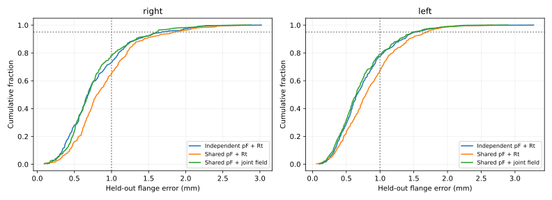
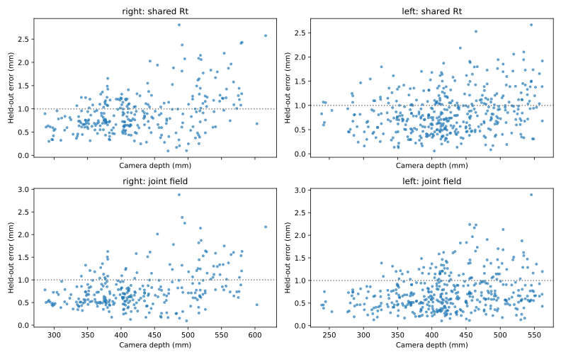

# 完全共享pF：Rt退化原因与联合平滑补偿改进

日期：2026-10-21。数据为2026-10-20最新两场采集，右288个有效位置、左424个有效位置，每位置50帧；保留全部712个有效位置，未按残差筛点。这里“完全共享”指pF，左右臂各有自己的外参，并不共用同一组Rt。

**结果：严格共享pF的新候选，以及内外层隔离的嵌套选型流程，均在左右臂RMS、P95、≤1mm比例六项指标上达到原独立pF＋Rt基线。改善依赖仿射修正和共用平滑场；仍不能宣称纯共享Rt具有同样表现，也未达到双臂P95≤1mm。**

## 同口径留出比较

| 方案 | 臂 | RMS mm | P95 mm | ≤1mm比例 | 最大 mm |
|---|---|---:|---:|---:|---:|
| 原独立pF＋Rt | right | 0.911763 | 1.677942 | 73.26% | 3.019876 |
| 原独立pF＋Rt | left | 0.866369 | 1.520132 | 77.36% | 3.276043 |
| 完全共享pF＋Rt | right | 1.017795 | 1.858729 | 65.28% | 2.807015 |
| 完全共享pF＋Rt | left | 0.959568 | 1.693835 | 67.22% | 2.664691 |
| 完全共享pF＋仿射 | right | 0.880453 | 1.626643 | 78.47% | 2.666396 |
| 完全共享pF＋仿射 | left | 0.870263 | 1.650371 | 77.12% | 3.298195 |
| 联合补偿候选 | right | 0.886663 | 1.611474 | 78.12% | 2.880588 |
| 联合补偿候选 | left | 0.841281 | 1.483607 | 79.01% | 2.897029 |
| 嵌套选型流程 | right | 0.874276 | 1.588026 | 77.43% | 2.570991 |
| 嵌套选型流程 | left | 0.831836 | 1.509054 | 79.01% | 2.780400 |



上表候选为固定超参数的5折留出分数；它经过本批数据选型，仍有选型偏差。嵌套行评价每个外层折只使用其训练数据进行内层选型的流程，并非一个固定全量模型的独立精度。两臂同时留出对应轨迹区块，两侧剔除相邻2个有效位置；同位置50帧不跨训练/验证。

## 为什么共享Rt性能变差

标定模型为 $y_i=R_s(a_i+Q_i p_F)+t_s$。其中y是相机球心，a/Q为MDH给出的法兰位置/旋转，pF为法兰局部到球心偏置。两臂分别估计时有18个几何变量；完全共享时为15个，少3个独立偏置自由度。

1. **数据中存在有效pF不一致。** 原独立右pF=[1.081859,-0.328129,101.347729]mm，左=[0.195295,0.725531,99.374025]mm，差的模长2.406596mm。同型同定位连接件支持物理偏置相同的先验，但这组拟合差异也可能吸收了相机、机器人模型或检测的偏差，并不能直接当成真实装配差。

2. **偏置误差随姿态旋转，固定t不能吸收。** 更换pF带来的球心变化为 $R_sQ_i\Delta p_F$。若Q不变，可被平移吸收；Q变化时一般不能由一个固定Rt完全吸收。

3. **可量化的约束代价，非简单未收敛。** 对独立最优解线性化，先投影掉各臂Rt的6维自由度，得到pF信息矩阵H。共享解近似为 p*=(H右+H左)⁻¹(H右·p右+H左·p左)。预测与实际结果如下，均为全量训练诊断，不是留出指标：

| 臂 | 实际共享增加SSE mm² | 一阶预测增加SSE mm² | 独立训练RMS mm | 共享训练RMS mm |
|---|---:|---:|---:|---:|
| right | 55.098941 | 55.074085 | 0.816986 | 0.926705 |
| left | 43.930565 | 43.941843 | 0.814088 | 0.875414 |

一阶预测共享pF为[0.6752264431289867, 0.1567631796328249, 100.14380963256669]mm；实际普通共享Rt为[0.674803641072813, 0.1564489735229362, 100.14343742744416]mm，两者非常接近。投影后的pF敏感矩阵每臂均为满秩，说明这些数据下改动pF造成的变化不能全部靠Rt抵消。该计算不证明误差的物理来源。

4. **残差带有空间与姿态结构。** 对全量共享Rt残差做描述性线性回归：相机XYZ可解释右约20.0%、左约19.2%的残差能量；姿态旋转矩阵元素可解释右约46.5%、左约24.1%。这些是样本内描述，不是泛化解释率或因果证据。相机残余视差/畸变、球心修正、关节零位/MDH、柔性或采集间安装变化都仍是可能因素。

## 本轮如何改进

使用一个严格共享pF、各臂刚体或仿射映射，以及两臂共用的高斯平滑场。对比两阶段拟合后，采用联合优化，避免先拟合Rt/pF后把不可兼容残差全部交给补偿场。

$$f(y)=y+\sum_j k(y,c_j)w_j,\quad k(y,c_j)=\exp[-\|y-c_j\|^2/(2\ell^2)]$$

$$\min_{M_s,t_s,p_F,W}\sum_{s,i}\|M_s(a_i+Q_i p_F)+t_s-f(y_i)\|^2+\alpha\,\mathrm{tr}(W^T K W).$$

核中心c只取当前训练折的相机XYZ，左右臂共享同一组系数W；无按臂分别拟合的隐藏pF或独立补偿场。固定几何变量时W=(K+αI)⁻¹E，E为“预测相机球心−观测相机球心”。代回后优化 α·tr(Eᵀ(K+αI)⁻¹E)，通过Cholesky白化计算。代码省略对当前候选固定的α乘子，不改变该候选最优解。

这称为变量投影：每次几何更新时精确解出平滑场系数；仿射模型提供解析几何雅可比。相机K/D、双目P_L/P_R、原始MDH保持固定。仿射元素限制在对应共享初值附近±0.03，最终奇异值限制在0.9～1.1；pF模长≤200mm。

最佳平衡候选为 **affine_l60_a3**：ℓ=60mm，α=3，共享pF（各自法兰局部，mm）为 **[0.8051722072317554, 0.2508674846906257, 100.58184753499467]**。最终未触及参数边界：True。

全量模型包含27个几何变量（两臂各12个仿射参数、共享pF的3个参数），以及712个核中心、2136个受正则约束的系数。中心数量不等于无约束自由参数数量。矩阵M可含尺度与剪切，不能标成旋转R，也不能直接塞入现有vision_deploy刚体加载器。



## 选型与验证限制

- 20种联合候选：仿射ℓ={30,40,60,100}mm、α={0.3,1,3,10}；刚体ℓ={40,100}mm、α={1,10}，另比较纯共享刚体/仿射两项基线。
- 外层5折、内层4折。内层也独立拟合原独立pF＋Rt基线；选择使六项“相对基线比值”的最大值最小的共享模型。RMS/P95用候选÷基线，≤1mm比例用基线÷候选，最大比值≤1代表六项全部达到基线；选型不读取外层验证分数。
- 固定候选最大相对比值=0.979104；嵌套流程=0.992712。外层各折选择：['affine_l30_a3', 'affine_l40_a3', 'affine_l30_a10', 'affine_l40_a3', 'affine_l30_a3']
- 本轮先探索36个两阶段核补偿组合和20个联合组合，再进行上述嵌套运行；此前还反复研究过同批数据。嵌套隔离减少本轮内部选型偏差，无法消除跨轮研究偏差。独立日期/轨迹和位置真值仍然缺少。
- 小幅尾部改善未证明统计显著。分数是50帧融合黄球观测相对名义FK的一致性，不能视为任意物体单帧绝对精度，也不能证明球心偏置估计等于真实制造尺寸。
- 所有核中心来自训练数据，未使用留出FK/姿态或时间/序号进行在线位置修正。空间支持距离见model_behavior.json；区域外高斯场虽衰减，仿射误差仍可能存在，不能保证外推精度。
- 非刚体修正可能吸收机械臂模型偏差。它提高相对名义FK的一致性，不代表物理基座中的独立真值精度必然提高；两臂之间的坐标对齐也随新映射重新估计。

## 从四维像素到位置

```text
左右像素 → 原双目模型三角化 y → 共用补偿 f(y)
       → 选定臂的 M_s⁻¹(f(y)−t_s) → 该臂MDH父系目标XYZ
标定验证：目标XYZ − Q_i·共享pF → 视觉法兰原点，与a_i比较
```

在线任意目标坐标不加减pF，也不需要关节角。下面示例在仓库根目录、安装requirements-analysis.txt依赖后运行：

```python
import json
from pathlib import Path
import numpy as np
from vision_deploy.stereo_robot import StereoRobot
from interactive_ball_calibration.improve_shared_pf import camera_to_arm

model = json.loads(Path('reports/shared_pf_joint_kernel_20261021/affine_l60_a3.json').read_text())
measurement = StereoRobot().predict([710, 569, 764, 569], arm='right')
# 上例使用校正后的左右像素；原始像素按StereoRobot文档指定pixel_domain。
y = np.array([measurement['camera_xyz_m']])
right_xyz_mm = camera_to_arm(y, model, 'right')[0] * 1000
left_xyz_mm = camera_to_arm(y, model, 'left')[0] * 1000
print(right_xyz_mm, left_xyz_mm)
```

示例复用现部署的像素→相机部分，然后调用实验模型；模型输出分别属于各自MDH父系。现部署的范围/元数据检查基于其原标定，此示例不构成完整生产接入。vision_deploy v2.4.0默认参数保持原值。

## 参数、证据与复现

- [完整候选参数](affine_l60_a3.json)：共享pF、左右M/t、核长度/正则、中心/系数及覆盖范围。
- [完整比较与划分](comparison.json)、[逐点留出误差](heldout_errors.csv)、[退化原因诊断](diagnostics.json)、[补偿幅度与覆盖](model_behavior.json)、[复核记录](VALIDATION.json)。
- fold_0_models.json.gz至fold_4_models.json.gz保存所有外层训练模型，可复算逐点分数。内层保存划分与分数，模型可通过代码复现，未重复存储。
- exploration目录保存先导实验脚本和结果，记录本轮探索范围；其中数据缓存只是本机临时加速，正式流程重新读取原始归档。

```bash
python -m interactive_ball_calibration.improve_shared_pf --output /tmp/shared_pf_joint_kernel
python -m interactive_ball_calibration.summarize_shared_pf_kernel /tmp/shared_pf_joint_kernel
python -m unittest tests.test_shared_pf_kernel -v
```

重新计算并核对17088条预测；5项测试覆盖无偏恢复、已知平滑偏差的未见位置改善、序列化一致性、输入校验、推理不依赖pF和六指标选型。未连接机器人/相机，也未替换默认部署。
