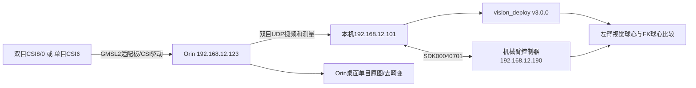

# Orin Pro 相机连接、实时校正与机械臂联合控制教程

整理日期：2026-10-21。适用于本项目现场设备与当前源码；默认视觉定位版本为 **vision_deploy v3.0.0**，左臂实时对比入口也已切回v3.0.0。本文命令区分“本机”和“Orin”，不要混用执行位置。

## 2026-10-22接线更新（优先于下方历史端口表）

用户确认相机及安装位置未变，仅更换适配板接口。已实测：**原左眼从CSI8/J29移到CSI1/J26，右眼仍CSI0/J25，单目仍CSI6/J27**。当前启动器读取完整项目`configs/orin_pro_camera_ports.json`，以`--sensors 1 0`启动双目。直接手工运行Orin的`pro_sender.py`时也必须添加这组参数。

原相机JSON的K/D/R/T及字节哈希不变；旧`sensor_ids`继续表示标定来源身份（左8/右0），新元数据`capture_sensor_ids`记录实际采集端口（左1/右0）。新采集会话保存实际端口且拒绝会话中换口。不能把这项映射用于更换相机或调整安装后的情况。

2026-10-21交付ZIP是当日端口快照，尚未包含此次映射修复；使用现场源码中的新配置和新脚本。下文CSI8左眼的历史指令，当前执行时应换成CSI1；标定参数文件中的身份保持不变。

## 1. 设备、地址和目录

| 项目 | 当前配置 |
|---|---|
| Orin Pro SSH | `192.168.12.123`，用户`marvin` |
| 本机有线地址 | `192.168.12.101/24`，网卡`eno0` |
| 机械臂控制器IP | `192.168.12.190` |
| SDK / 控制器版本 | **`00040701` / `00040701`** |
| 机器人 | Marvin Pro M6S-CCS-696，左右臂各7轴 |
| 左臂 / 右臂 | ARM0 / ARM1，MDH前缀`R.A0` / `R.A1` |
| 双目左眼 / 右眼 | CSI8（`/dev/video8`）/ CSI0（`/dev/video0`） |
| 单目鱼眼 | CSI6（`/dev/video6`，`shw5g 12-001b`） |
| Orin相机环境 | AGX Orin，JetPack6.2 / L4T36.4.3，Argus、GStreamer、VPI |
| 本机完整项目 | `/home/lijingzhi/Project/Learned_IK/head_eye_pro` |
| 本机机器人SDK | `/home/lijingzhi/Project/Learned_IK/00040701/PYTHON_SDK/` |
| Orin采集脚本目录 | `/home/marvin/head_eye_pro/`，目前使用平铺脚本副本 |
| Orin远程桌面 | 当前`DISPLAY=:1001`，X认证`/home/marvin/.Xauthority` |

地址、桌面编号和节点映射是这台设备的现场配置，不是厂商出厂默认值。迁移设备或换线后需要重新确认。

本文不保存SSH口令；连接时交互输入。SDK连接的是控制器，不使用Orin SSH密码。



## 2. 先连接Orin和确认相机

### 2.1 本机执行

```bash
ip -br -4 addr
ping -c 3 192.168.12.123
ssh marvin@192.168.12.123
```

本机同时有Wi-Fi和有线网卡时，确认`192.168.12.0/24`走有线网卡。更换接收电脑后，不仅要能SSH，Orin推流的`--host`也要改成新电脑地址；当前启动器硬编码目标为`192.168.12.101`。

### 2.2 登录后在Orin执行

```bash
cat /etc/nv_tegra_release
v4l2-ctl --list-devices
ls -l /dev/video*
gst-inspect-1.0 nvarguscamerasrc
gst-inspect-1.0 nvvidconv
```

现场驱动会注册`video0`～`video9`，不代表实际连接了10台相机。应结合链路日志和实际出图判断：

```bash
journalctl -k -b --no-pager | grep -E 'link_status|cur_link_status|video lock'
```

CSI8/0对应原双目；2026-10-21重启后的日志新增确认CSI6链路连接，且已实测出图并完成单目标定。

## 3. 双目、单目硬件和软件准备

### 3.1 双目连接

SHW5G鱼眼相机经GMSL2适配/解串板接入Orin，再由CSI/Argus驱动读取，不是USB UVC或自带RTSP地址的摄像头。厂商端口表记录J29→video8、J25→video0；实际左右身份仍需逐眼遮挡确认。

相机线缆、适配板供电、触发针脚按实际板卡手册接线。仓库没有完整硬件BOM或已验证触发电平定义，不按节点名猜供电和针脚。

已有图像时无需重装驱动。新系统的匹配驱动安装、Jetson-IO选择、模块加载步骤见[厂商说明](vendor_camera_driver_readme.md)和[双目连接详细说明](camera_connection.md)。必须匹配JetPack/L4T版本。

### 3.2 单目连接

CSI6同样经过GMSL/CSI链路，厂商端口表记录 **J27→`/dev/video6`**；换板卡或驱动后需按实际映射确认。先核对：

```bash
# Orin执行；这些查询不打开视频流
v4l2-ctl -d /dev/video6 --all
v4l2-ctl -d /dev/video6 --get-ctrl=trig_mode
```

本次单目参数只属于CSI6这台相机，不能用双目左眼或右眼K/D替代。三台相机当前原始成像模式均为2560×1984、mode0、请求30FPS。

### 3.3 两类软件依赖

| 功能 | 依赖 |
|---|---|
| Orin采集/双目VPI校正 | 驱动、Argus、GStreamer、`nvvidconv`、VPI、OpenCV、NumPy、Python GI |
| 本机双目视频接收 | `/usr/bin/python3`、支持GStreamer的系统OpenCV、对应RTP/H264解码插件 |
| 本机SSH启动/棋盘采集 | Paramiko、OpenCV、NumPy |
| 机械臂控制 | 同级目录的厂商SDK00040701和匹配架构动态库 |
| 单纯运行`StereoRobot.predict()` | Python≥3.10、NumPy、OpenCV；无需SDK或相机驱动 |

**只安装vision_deploy wheel不包含本机相机启动器、机器人SDK或Orin驱动。** 本教程中`start_left_live_compare.py`、`orin_rectified_stream/`、`scripts/`等命令需要完整`head_eye_pro`源码。

## 4. 在本机打开双目校正实时画面

以下均在本机执行：

```bash
cd /home/lijingzhi/Project/Learned_IK/head_eye_pro
/usr/bin/python3 orin_rectified_stream/start_pro_rectified.py
```

按提示输入Orin密码。启动器上传相机脚本和当前相机JSON，正常停止本项目旧采集进程，再启动Orin校正推流和本机窗口；此入口不连接机械臂。

处理链：

```text
每眼Argus 2560×1984@30
→ 缩到1280×992
→ VPI CUDA鱼眼去畸变和双目极线校正
→ 原生校正像素检测、配帧和三角化
→ 每眼640×496 H264显示流（约12FPS）+ 独立测量元数据
```

| 内容 | Orin→本机端口 |
|---|---:|
| 左眼校正预览 | UDP/RTP 5120 |
| 右眼校正预览 | UDP/RTP 5122 |
| 质量、像素、三角化结果 | UDP JSON 5124 |

图像窗口中每眼显示转180°，测量域不旋转。窗口按G开关参考线，Q关闭。

如果Orin推流已正常运行，只想打开接收窗口：

```bash
/usr/bin/python3 orin_rectified_stream/pro_viewer.py
```

同一台接收电脑只开一个本项目接收窗口，避免5120/5122/5124占用冲突。左臂一键对比入口会替换普通接收窗口，无需同时手工运行两个接收器。

### 4.1 只重启双目采集

先结束正式采集；在本机项目根目录执行：

```bash
/usr/bin/python3 -c "from orin_rectified_stream.start_pro_rectified import prepare_sender; prepare_sender(reuse_running=False)"
```

它会重新自动适应约5秒再锁定AE/AWB，过程中画面和测量会暂时中断；不会连接机械臂。现有启动器会停止本项目的`orin_pro_capture_server.py`，其中也包括CSI6单目服务，因此不要在单目标定保存期间执行此命令。

重启成功不等于配帧达标：现场既有重启后高配对率的会话，也有几乎没有合格配对的会话。必须查看当次状态。

## 5. 在Orin桌面打开双目校正画面

主推流程序的`--host`目前只支持一个目的地址。本节把视频发给Orin自身；第4节发给本机，两种模式二选一。要运行本机机械臂联合对比，使用第4/9节的`.101`目的地址。

首次先按第4节让启动器部署过相机脚本/参数。正常退出本机联合控制窗口使左臂回到IDLE，然后在Orin终端执行：

```bash
pkill -INT -f '[/]home/marvin/head_eye_pro/pro_sender.py' || true
while pgrep -f '[/]home/marvin/head_eye_pro/pro_sender.py' >/dev/null; do sleep 0.2; done
/usr/bin/python3 -u /home/marvin/head_eye_pro/pro_sender.py \
  --calibration /home/marvin/head_eye_pro/raw_fisheye_stereo.json \
  --host 127.0.0.1 --yellow
```

若旧进程不能正常退出，先检查日志和占用，不继续叠加新采集进程。上面的推流保持前台运行，另开两个Orin终端分别接收左右眼：

```bash
# Orin终端2：左眼CSI8
DISPLAY=:1001 XAUTHORITY=/home/marvin/.Xauthority gst-launch-1.0 -e \
  udpsrc port=5120 caps='application/x-rtp,media=video,encoding-name=H264,payload=96,clock-rate=90000' ! \
  rtpjitterbuffer latency=30 drop-on-latency=true ! rtph264depay ! h264parse ! \
  nvv4l2decoder ! nvvidconv flip-method=2 ! 'video/x-raw,format=BGRx' ! \
  videoconvert ! ximagesink display=:1001 sync=false
```

```bash
# Orin终端3：右眼CSI0
DISPLAY=:1001 XAUTHORITY=/home/marvin/.Xauthority gst-launch-1.0 -e \
  udpsrc port=5122 caps='application/x-rtp,media=video,encoding-name=H264,payload=96,clock-rate=90000' ! \
  rtpjitterbuffer latency=30 drop-on-latency=true ! rtph264depay ! h264parse ! \
  nvv4l2decoder ! nvvidconv flip-method=2 ! 'video/x-raw,format=BGRx' ! \
  videoconvert ! ximagesink display=:1001 sync=false
```

这是两个已校正视频窗口；`flip-method=2`只将显示转180°。已检查Orin具有NVIDIA解码器、转换器和X显示插件，完整的本机环回显示命令本次未切换现场推流实跑。桌面编号改变时修改DISPLAY。

切回本机接收前，关闭上述Orin接收窗口和推流，再在本机执行第4.1节强制准备命令，将`--host`恢复`.101`。不要只依赖“复用运行中sender”：现有复用检查只核对进程和相机哈希，不核对它的目的地址。

## 6. 在Orin打开CSI6单目原图/去畸变实时对比

### 6.1 第一次部署文件：本机执行

```bash
cd /home/lijingzhi/Project/Learned_IK/head_eye_pro
ssh marvin@192.168.12.123 'mkdir -p /home/marvin/head_eye_pro'
scp portable_stereo_fisheye_calibration/orin_pro_capture_server.py \
  marvin@192.168.12.123:/home/marvin/head_eye_pro/orin_pro_capture_server.py
scp portable_stereo_fisheye_calibration/mono_live_compare.py \
  marvin@192.168.12.123:/home/marvin/head_eye_pro/mono_live_compare.py
scp vision_deploy/mono_csi6/calibration.json \
  marvin@192.168.12.123:/home/marvin/head_eye_pro/mono_csi6_fisheye_20261021.json
```

当前Orin已部署这些文件，无需每次复制。不要在旧采集进程还运行时边替换脚本边重启；先正常结束该相机的旧会话。

### 6.2 启动单目采集：Orin执行

先检查是否已启动或被其他预览占用：

```bash
pgrep -af 'orin_pro_capture_server.py|gst-launch|mono_live_compare.py'
```

已有`--sensor 6 --port 8767`服务则复用；没有服务时启动一次：

```bash
nohup /usr/bin/python3 -u /home/marvin/head_eye_pro/orin_pro_capture_server.py \
  --sensor 6 --port 8767 \
  > /home/marvin/head_eye_pro/mono_csi6_capture.log 2>&1 < /dev/null &
```

等待约5秒，检查：

```bash
curl http://127.0.0.1:8767/status
```

应看到`sensors:[6]`、`image_size:[2560,1984]`、`locked:true`、两项锁均为true、防频闪值2，帧年龄持续较小且时间戳更新。

### 6.3 启动实时对比：Orin执行

```bash
DISPLAY=:1001 XAUTHORITY=/home/marvin/.Xauthority \
/usr/bin/python3 /home/marvin/head_eye_pro/mono_live_compare.py \
  --calibration /home/marvin/head_eye_pro/mono_csi6_fisheye_20261021.json
```

左RAW，右UNDISTORTED，实测约12.5FPS，每侧640×496；两侧取自同一原始预览帧。先按缩放后的K去畸变，再只在显示时转180°。程序复用8767服务，不重新打开CSI6。Q/Esc关闭对比窗口，采集服务继续保持锁定。

需要在本机取单目HTTP预览时，可建立SSH隧道：

```bash
# 本机终端1保持运行
ssh -N -L 18767:127.0.0.1:8767 marvin@192.168.12.123
# 本机终端2：获取一张原始预览，不是去畸变结果
curl http://127.0.0.1:18767/preview -o /tmp/csi6_raw_preview.jpg
```

如需重新采棋盘，完整项目入口是`portable_stereo_fisheye_calibration/calibrate_mono_orin_pro.py`，详见[CSI6单目附件说明](../../mono_csi6/README.md)。

## 7. 曝光、白平衡及其他成像参数

双目和单目使用相同策略，但自动适应后得到的实际曝光/增益不保证相同。

| 参数 | 当前策略/已记录状态 |
|---|---|
| `sensor-mode` | 0 |
| 采集请求 | 2560×1984、NV12、30/1 FPS；后续ISP转换为BGR |
| `aeantibanding` | 2，表示50Hz |
| 初始`aelock` / `awblock` | false / false，先自动适应 |
| 约5秒后 | 两项设true并回读；采集保存和测量检查锁定状态 |
| 曝光范围/模拟增益范围/ISP数字增益范围 | 程序未固定设置；历史回读为None，非明确数值范围 |
| `wbmode` | 历史回读1（自动模式），随后锁AWB |
| `tnr-mode` / `tnr-strength` | 历史回读1 / −1.0 |
| `ee-mode` / `ee-strength` | 历史回读1 / −1.0 |
| `saturation` | 历史回读1.0 |
| `trig_mode` | 当前0，自由运行；不是硬件曝光同步 |

其中AE/AWB锁定、防频闪和模式由入口明确配置；wbmode、降噪、锐化、饱和度是既有双目会话的默认回读记录，不是脚本逐项强制值，也没有逐项证明单目值完全相同。

查询驱动控制值（Orin执行）：

```bash
v4l2-ctl -d /dev/video8 --get-ctrl=exposure,gain,trig_mode
v4l2-ctl -d /dev/video0 --get-ctrl=exposure,gain,trig_mode
v4l2-ctl -d /dev/video6 --get-ctrl=exposure,gain,trig_mode
tail -15 /home/marvin/head_eye_pro/rectified_sender.log
```

驱动控制回读仍不等于已独立验证的逐帧曝光时间。不要把“锁定曝光”理解为已强制固定20ms或固定某个gain；旧Orin的实际曝光/增益没有完整保存，当前复用的是策略。

## 8. 当前相机标定参数

以下数值四舍五入显示，程序以JSON全精度为准。K和D对应未经显示旋转的原始图像。

| 原始相机 | fx | fy | cx | cy |
|---|---:|---:|---:|---:|
| 双目左CSI8 | 973.440337 | 973.185288 | 1300.297990 | 970.540188 |
| 双目右CSI0 | 974.700080 | 974.456713 | 1299.439318 | 987.253950 |
| 单目CSI6 | 975.120003 | 974.911383 | 1287.688560 | 985.011657 |

三者分辨率均2560×1984；`K=[[fx,0,cx],[0,fy,cy],[0,0,1]]`，畸变模型均OpenCV fisheye四项：

```text
CSI8 D = [ 0.2382494793, -0.0217194309, -0.0972096788,  0.0278717647]
CSI0 D = [ 0.2377294461, -0.0082677538, -0.1443914165,  0.0726208359]
CSI6 D = [ 0.2382124085, -0.0200247281, -0.1101762914,  0.0387055544]
```

双目右眼相对左眼的原始外参：

```text
R = [[ 0.9999709424, -0.0063259819, -0.0042539817],
     [ 0.0063296052,  0.9999796160,  0.0008388363],
     [ 0.0042485886, -0.0008657379,  0.9999906000]]
T = [0.05974044356, 0.00024042050, 0.00032418396] m
基线长度 = 59.74180692 mm
```

| 校正/去畸变图像 | 参数 |
|---|---|
| 双目1280×992理想针孔校正图 | 两眼fx=fy=398.047518，cx=661.773287，cy=486.006270，D=0 |
| 单目2560×1984去畸变图 | 新fx=796.444477，fy=796.274083，cx=1301.534119，cy=981.362952，balance=0 |
| 单目640×496显示 | 原K和新K的前两行各缩放0.25，D不变 |

双目实际T.x为正，前方点视差可以为负；不要交换左右或对T取绝对值。显示640×496、旋转180°后的像素不能直接喂给双目1280×992坐标接口。

参数文件：

- [双目原始鱼眼K/D/R/T和校正R/P/Q](../calibration/raw_fisheye.json)
- [双目1280×992校正模型](../calibration/rectified_stereo.json)
- [CSI6单目K/D和去畸变新K](../../mono_csi6/calibration.json)
- [CSI6校验与使用说明](../../mono_csi6/README.md)
- [机械臂完整MDH配置](../calibration/robot_geometry.ini)
- [v3双臂映射参数](../calibration/arms.json)、[共享补偿](../calibration/observation_correction.json)、[pF与双臂关系](../calibration/arm_alignment.json)

双目65对棋盘的原分辨率双目RMS约0.149801px、校正纵差P95约0.296672px。单目40张重投影RMS约0.104942px、二维误差P95约0.191604px。两类P95定义不同，不能直接比较；均为同批图像指标，不代表三维1mm验收。

## 9. 相机和机械臂同时运行：左臂拖动＋视觉/FK对比

### 9.1 操作前提

黄球固定在左臂法兰末端，两眼可见；安装关系不变。控制器版本00040701，左臂先为IDLE、无未处理故障，关节距实时限位至少2°；其他SDK客户端已断开。退出其他现场控制任务后再启动。

本机执行：

```bash
/usr/bin/python3 /home/lijingzhi/Project/Learned_IK/head_eye_pro/start_left_live_compare.py
```

该入口可以从任意目录运行。目前明确导入完整项目内`vision_deploy.stereo_robot`的v3.0.0代码，并从同目录`calibration/`读参数，不依赖系统里另装的旧wheel。

当前v3.0.0 bundle ID为：

```text
a473f5f64f33b4434e6a8cc9af3164c4ee41f8e0e7616700f40adbff8e002b55
```

启动流程：复用/准备Orin双目 → 打开本机视频接收 → 检查控制器版本、实时反馈、7轴、32项MDH及限位、左臂IDLE → 进入ARM0 DragJoint → 同时显示视觉位置和FK球心位置。按住左臂实体拖动按钮操作。

实时拖动不等待满足正式采集吞吐量的双目帧；双目不合格或数据过期时显示WAIT并隐藏视觉误差，左臂反馈和状态仍被检查。当前共享pF为：

```text
[0.805172207, 0.250867485, 100.581847535] mm
```

FK使用 `R_M_F(q)*pF+t_M_F(q)`；视觉位置通过v3.0.0双目接口得到。两者都在左臂MDH父坐标系下比较，差值为`Vision−FK`。pF不参与通用物点接口本身的XYZ推理。

### 9.2 退出和状态证据

Q/Esc关闭窗口，或在启动终端Ctrl+C。程序尝试ARM0回IDLE并断开SDK；如果发生通信故障，应从控制器确认实际状态，不能仅凭窗口关闭认定清理成功。

本机状态路径：

| 文件 | 内容 |
|---|---|
| `runtime/drag_replay_session.json` | 当前阶段、臂侧、使用的pF和bundle ID |
| `runtime/rectified_pro/status.json` | 图像年龄、检测和视觉/FK比较状态 |
| `runtime/rectified_pro/stereo.jpg` | 当前窗口快照 |
| `runtime/yellow_detection/latest_status.json` | 每条测量/拒绝状态 |
| `runtime/yellow_detection/latest.json` | 最近PASS测量，可能已经过期 |

实时比较按本机报文接收时刻选最近关节反馈，最大允许50ms差；相机测量年龄≤250ms，关节反馈年龄≤200ms。这不是曝光时间与关节反馈的硬同步，拖动时误差包含时延，静态判断需停稳。

该入口只控制左臂，不控制右臂或头部；不是轨迹录制程序。不能同时再启动示教/回放SDK进程。

### 9.3 单目画面与机械臂并行

如果只需“看CSI6画面＋操作机械臂”，在Orin按第6节保持单目采集/显示，在本机或控制器配套客户端控制机器人；两个链路可分开运行，但只能保留一个SDK控制客户端。也可先运行第10.1节只读示例核查控制器反馈。

当前没有“CSI6单目图像→三维球心→机械臂FK比较”的一键入口；单目相机只有K/D，缺少深度来源和相机到机器人配准。不要用第9.1节的双目启动器当作单目启动器，其冷启动还会停止本项目单目HTTP采集服务。

## 10. 机械臂独立连接、读取和控制入口

### 10.1 SDK只读示例

先退出第9节实时对比并确认IDLE，避免独占连接冲突。以下在本机项目根目录执行，只读取版本、状态和七关节反馈，不切模式、不运动：

```bash
/usr/bin/python3 - <<'PY'
import sys, time
sys.path.insert(0, '../00040701')
from PYTHON_SDK import GentoRobot as sdk

robot = sdk.GentoRobot(precision=6)
try:
    code = robot.link(192, 168, 12, 190,
        log_level=sdk.FXLogMask.FX_LOG_INFO_FLAG)
    if not robot._connected:
        raise RuntimeError(f'Controller link failed: {code}')
    assert robot.get_sdk_version() == '00040701'
    assert robot.get_controller_version() == '00040701'
    initial = robot.get_rt_dict().get('frame_serial')
    for _ in range(100):
        time.sleep(.01)
        rt = robot.get_rt_dict()
        if rt.get('frame_serial') != initial and 'arms' in rt:
            break
    else:
        raise RuntimeError('No fresh feedback')
    for side, index, obj in [('left', 0, sdk.FXObjType.OBJ_ARM0),
                             ('right', 1, sdk.FXObjType.OBJ_ARM1)]:
        state = sdk.state_map.get(robot.current_state(obj), 'Unknown')
        print(side, state, 'q_deg=', rt['arms'][index]['fb']['fb_pos'])
finally:
    if robot._connected:
        robot.unlink()
PY
```

实际拖动入口使用的SDK操作为`switch_to_drag_joint`，退出使用`switch_to_idle`，连接释放使用`unlink`。本项目已在这些操作前后加入MDH/限位/状态检查及异常清理，建议使用第9/11节完整入口，而非只复制模式切换调用。

### 10.2 控制器被占用或故障

`-22`表示控制器被其他客户端占用；本机没有Python进程不代表Orin上没有客户端。曾确认Orin的Apex机器人容器占用控制器。

先在所属客户端停止任务并断开；若确定要关闭Orin Apex，在Orin退出Apex界面，并执行：

```bash
sudo /usr/local/bin/apexctl stop teleop
sudo /usr/local/bin/apexctl stop robot
sudo systemctl stop apex-backend.service
```

保留`apex-dnsmasq`等网络服务。上述操作不禁用开机自启动。不要为了释放控制器而重置网络、强抢连接或自动清除故障。

## 11. 双目＋机械臂示教、回放和50帧采集

首先正常退出实时对比，让SDK释放。按第4节单独保持双目接收窗口运行，然后另开本机终端：

```bash
cd /home/lijingzhi/Project/Learned_IK/head_eye_pro
# 二选一，只读预检
bash scripts/teach_replay_left.sh teach --check
bash scripts/teach_replay_ball.sh teach --check
```

正式采集预检要求连续3个5秒窗口，每窗至少25个双眼唯一PASS帧；随后连接目标臂并检查IDLE/MDH等。通过后，二选一开始示教：

```bash
# 左臂ARM0
bash scripts/teach_replay_left.sh teach
# 或右臂ARM1
bash scripts/teach_replay_ball.sh teach
```

按住所选臂拖动按钮缓慢示教，约每3°记录一点。Ctrl+C结束后保存轨迹、尝试IDLE，保持末点稳定；程序展示返回/回放计划，操作者输入RUN才运动。至少18点可保存回放路径，后续拟合需要至少30个有效位置，应留出无效点余量。

回放先以SDK速度/加速度5%返回末点，再沿示教轨迹逆序停稳采集。必要的返回段是关节插值，没有障碍物碰撞规划。已有轨迹复用：

```bash
bash scripts/teach_replay_left.sh replay data/会话目录/taught_trajectory.json
# 右臂用teach_replay_ball.sh；中断前缀需明确添加--recover-partial并通过身份/限位校验
```

每位置在15秒内融合50个每眼不重复的有效帧，要求关节稳定、双时差≤10ms，原始/球心修正视差抖动P95≤0.1px；完整50帧窗口任一关节跨度≤0.02°。**50帧/位置不等于50FPS。** 不合格位置保留并标记`capture_valid=false`，不当作有效标定点。

本流程不采头姿、不控制头部。CSI6当前只有相机K/D，尚未标定单目到机械臂的外参/深度来源，不能直接替代双目采集链输出三维球心。

## 12. 同步、精度和常见问题

双目要求源时差和回调到达时差均≤**10毫秒**，不是10秒。30FPS帧周期约33.3ms；两眼自由运行相位漂移，最近邻帧也可能相差约16.7ms。共同软件时钟、重启或锁曝光都不构成硬件曝光同步。

现场外部触发接线尚未确认，`trig_mode=1`曾无有效图像，当前恢复0。不要只改触发模式或放宽时间门槛来声称同步修复。

| 现象 | 处理方向 |
|---|---|
| 双目有图但一直WAIT | 看两个时差、是否最新PASS、曝光锁和目标检测；二维预览可以独立持续 |
| 重启后仍无合格配对 | 记录当次有效配对率；自由运行相位可能仍不合适，不能认定可采集 |
| `Address already in use` | 查`ss -lunp`中5120/5122/5124占用，正常关闭旧接收器，避免并开 |
| `Failed to create CaptureSession` | 先查同sensor的已有Argus/gst-launch采集；CSI6曾被旧预览独占 |
| 单目原图正常、对比WAIT | 检查8767服务、K/D身份、帧时效以及是否被双目冷启动停止 |
| 本机收不到视频 | 核对sender的`--host`，尤其是否遗留127.0.0.1；检查UDP路由/解码插件 |
| `Cannot query video position` | 实时流不提供文件播放位置的警告，本身不是退出原因 |
| 控制器`-22` | 其他客户端占用，检查Apex/其他电脑，正常释放SDK |
| 非IDLE、Error或限位余量不足 | 从控制器处理原因并恢复；脚本不自动清错或接管活动任务 |
| 静止误差很大 | 核查目标、球的安装、左右身份、像素域、MDH、pF、参数版本和覆盖范围 |

当前v3固定候选分段留出右/左臂RMS约0.887/0.841mm，P95约1.611/1.484mm，**未通过P95≤1mm**。输出是MDH父系，实际物理基座关系未独立验证。单个实时误差小或棋盘RMS低，不代表完整工作空间绝对精度已达标。

## 13. 现场常用命令速查

| 目标 | 执行位置与入口 |
|---|---|
| SSH到Orin | 本机：`ssh marvin@192.168.12.123` |
| 本机看双目校正 | 本机完整项目：`/usr/bin/python3 orin_rectified_stream/start_pro_rectified.py` |
| 左臂拖动＋视觉/FK比较 | 本机：`/usr/bin/python3 /home/lijingzhi/Project/Learned_IK/head_eye_pro/start_left_live_compare.py` |
| Orin看单目原图/去畸变 | Orin：第6节8767服务＋`mono_live_compare.py` |
| Orin看双目校正 | Orin：第5节sender指向127.0.0.1＋两路GStreamer接收 |
| 左臂示教/采集 | 本机完整项目：`bash scripts/teach_replay_left.sh teach` |
| 右臂示教/采集 | 本机完整项目：`bash scripts/teach_replay_ball.sh teach` |
| 正常退出联合运行 | 窗口Q/Esc或启动终端Ctrl+C，核对IDLE和SDK断开 |

配套资料：[部署API](../../README.md)、[相机驱动连接细节](camera_connection.md)、[机器人MDH和坐标](robot_model.md)、[CSI6单目参数](../../mono_csi6/README.md)、[交付说明](../../DELIVERY_README.md)。最新交付ZIP附带现场工具集；SDK、驱动及平台依赖仍需另行准备。
